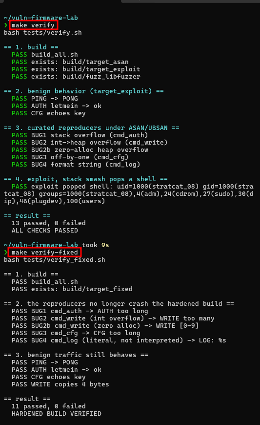
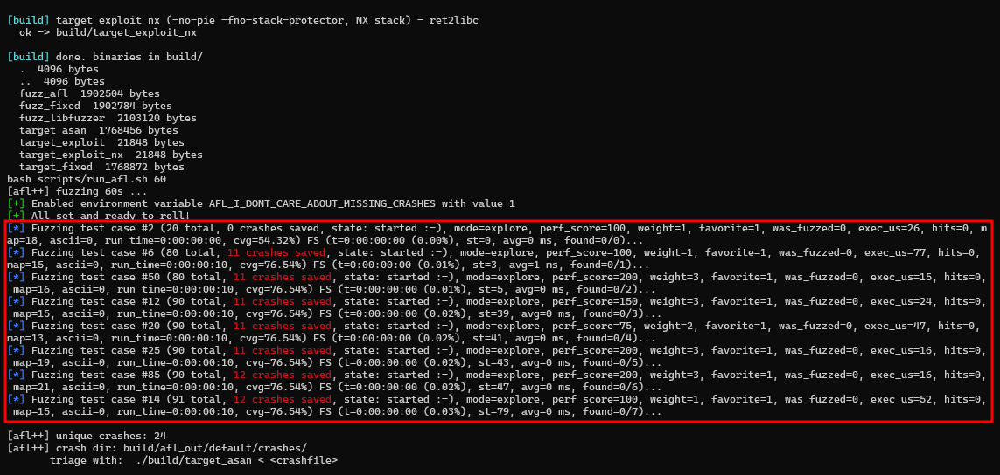
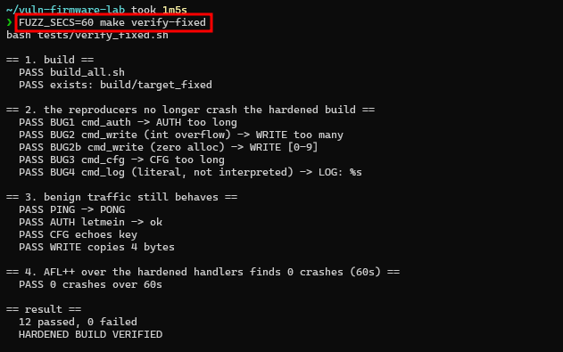

# Vuln-Firmware Lab

[](https://github.com/aashraymt/vuln-firmware-lab/actions/workflows/ci.yml)

A deliberately vulnerable firmware style target and the offensive and defensive
tooling that breaks it and then fixes it, end to end: plant the bugs, fuzz them
out, triage the crashes, weaponize one into a shell, write the fix, and prove
the fix holds under the same fuzzing that found the bug.

The target is a small C device that speaks a line oriented command protocol over
what would be a UART, the same shape as an embedded target. It carries four independent, documented memory safety bugs. The
offensive side harnesses it under libFuzzer and AFL++, triages the crashes back
to root cause, and turns the stack overflow into a working `ret2shellcode`
exploit that pops `/bin/sh`. The defensive side re links the same firmware
against a hardened set of handlers and demonstrates that a fresh campaign finds
nothing.

> This is a training target. Every bug is intentional and lives behind the `BUG
> N` comments in `firmware/commands.c`. Nothing here is meant to run anywhere
> real. It exists to be fuzzed and debugged on your own machine. See
> [SECURITY.md](SECURITY.md).

This is the C and memory corruption sequel to
[Evo-Fuzz](https://github.com/aashraymt/Evo-Fuzz), my Python, web API target,
first fuzzer: same instinct, generate inputs and find the crash, one abstraction
layer down, in the land of saved return addresses and sanitizer redzones.

## Proof

One command proves the offensive half and one proves the defensive half. Both
runs below are from a clean build on my own machine (Kali on WSL 2):



The same AFL++ harness, 60 seconds each: the vulnerable handlers give up 24
unique crashes, the hardened handlers give up none.





## The four bugs

| # | Handler     | Class                                   | CWE           | Found by            |
|---|-------------|-----------------------------------------|---------------|---------------------|
| 1 | `cmd_auth`  | Stack buffer overflow (`strcpy`)        | CWE-121       | AFL++, then exploited |
| 2 | `cmd_write` | Integer overflow into heap overflow     | CWE-190, 787  | libFuzzer and AFL++ |
| 3 | `cmd_cfg`   | Off by one NUL write                    | CWE-193       | libFuzzer and AFL++ |
| 4 | `cmd_log`   | Uncontrolled format string              | CWE-134       | libFuzzer and AFL++ |

Each is written up in `docs/` with the root cause at the source and assembly
level, the crashing input, the sanitizer trace, and the fix.

## Quick start

```bash
make build            # build every variant (gcc, clang, afl-clang-fast)
make verify           # benign traffic, all 4 bugs, the exploit; ends green
make verify-fixed     # the hardened build is not vulnerable; ends green
```

`make verify` is the one command that proves the offensive half from a clean
build. It ends with `ALL CHECKS PASSED`. `make verify-fixed` proves the
defensive half and ends with `HARDENED BUILD VERIFIED`.

### Fuzz it yourself

```bash
make fuzz-libfuzzer SECS=60      # coverage guided, clang libFuzzer and ASAN
make fuzz-afl        SECS=90     # AFL++ persistent mode and ASAN
make triage                      # bucket the crashes by (class, function)
```

### Pop the shell, and see what NX changes

```bash
make exploit                     # stack smash to execve("/bin/sh"), runs id
make nx-demo                     # NX blocks the shellcode but not RIP control
python3 exploit/exploit.py --interactive   # drop into the popped shell
```

## Layout

```
firmware/
  firmware.h          protocol and entry point contract
  firmware.c          parser, dispatch, UART style stdin front end (clean)
  commands.c          the command handlers, one planted bug each
  commands_fixed.c    the same handlers with every bug fixed (the defense)
fuzz/
  harness_libfuzzer.c LLVMFuzzerTestOneInput into fw_feed()
  harness_afl.c       AFL++ persistent mode loop into fw_feed()
  corpus/             seed inputs (valid protocol)
  dict/firmware.dict  token dictionary for the mutators
exploit/
  exploit.py          ret2shellcode for BUG 1 (auto scans the return address)
  nx_demo.py          NX blocks shellcode, RIP control survives
  shellcode.asm       documented execve("/bin/sh"), NUL free
  cyclic.py           De Bruijn pattern helper (offset discovery)
tests/
  repro/              deterministic one per bug reproducers
  verify.sh           the offensive end to end self check
  verify_fixed.sh     the defensive regression check
scripts/
  build_all.sh  run_libfuzzer.sh  run_afl.sh  triage.sh
docs/
  00-overview.md  threat-model.md  bug-01..04-*.md
  exploit-walkthrough.md  nx-and-rop.md  fuzzing-notes.md
  hardening.md  reproducing.md
  evidence/           saved sanitizer traces and fuzzer found reproducers
```

## The build variants

One codebase, compiled six ways. This separation is what makes the lab work: the
sanitizer builds detect the bugs, the exploit builds weaponize them, and the
fixed build proves the repair.

| Binary               | Flags                                                   | Purpose |
|----------------------|---------------------------------------------------------|---------|
| `fuzz_libfuzzer`     | `clang -fsanitize=fuzzer,address,undefined`             | live libFuzzer campaign |
| `fuzz_afl`           | `afl-clang-fast` with ASAN, persistent mode             | AFL++ campaign |
| `target_asan`        | `clang -fsanitize=address,undefined -O0`                | deterministic reproduction and triage |
| `target_exploit`     | `gcc -no-pie -fno-stack-protector -z execstack -O0`     | the ret2shellcode target |
| `target_exploit_nx`  | `gcc -no-pie -fno-stack-protector -O0` (NX on)          | shows NX blocking shellcode |
| `target_fixed`       | `clang -fsanitize=address,undefined` on `commands_fixed.c` | proves the fix |

## Documentation

The `docs/` tree is published as a GitBook (`.gitbook.yaml` and
`docs/SUMMARY.md`). Start with `docs/00-overview.md` for the full narrative and
`docs/threat-model.md` for the attack surface. `docs/fuzzing-notes.md` explains
why AFL++ found the stack overflow that libFuzzer stalled on, and
`docs/hardening.md` shows the fix holding under a fresh campaign.

## Requirements

- `clang` with its sanitizer runtime (`libclang-rt-18-dev` on Ubuntu 24.04)
- `gcc`, `gdb`, `binutils`
- `AFL++` (`apt-get install afl++`) for the AFL campaign
- `python3` and `setarch` (from `util-linux`) for the exploit

Full environment and expected output are in `docs/reproducing.md`.

## Security and responsible use

This is an intentionally vulnerable training target. Do not deploy it or reuse
its handlers. Scope and reporting guidance are in [SECURITY.md](SECURITY.md).

## License

[MIT](LICENSE), with an intentionally vulnerable code notice.
