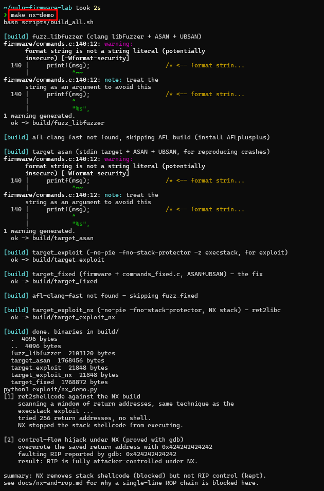

# NX: what it stops, what it does not, and the ROP constraint

The main exploit in [exploit-walkthrough.md](exploit-walkthrough.md) runs
shellcode on the stack, which works only because `build/target_exploit` is
compiled with an executable stack (`-z execstack`). This page turns that one
mitigation back on. `build/target_exploit_nx` is the same vulnerable code built
without an executable stack, so NX (the no execute bit on stack pages) is in
force. `exploit/nx_demo.py` reproduces everything below.

## Confirm the two binaries differ only in NX

```
$ readelf -l build/target_exploit    | grep GNU_STACK   # RWE, stack executable
$ readelf -l build/target_exploit_nx | grep GNU_STACK   # RW,  stack not executable
```

Both are non PIE and have no stack canary. The only change is the stack's
execute permission.

## Result 1: NX kills the ret2shellcode

The exploit that pops a shell against the executable stack build fails against
the NX build. The saved return address still points into the stack and is still
fully attacker controlled, but the processor faults the instant it tries to
execute the first shellcode byte, because the page is no longer executable.

```
[1] ret2shellcode against the NX build
    scanning a window of return addresses, same technique as the
    execstack exploit ...
    tried 256 return addresses, no shell.
    NX stopped the stack shellcode from executing.
```

This is the direct, visible value of NX: the exact attack that worked a moment
ago no longer does, and nothing about the bug or the overflow changed.

## Result 2: NX does not stop control-flow hijacking

NX removes the ability to run code on the stack. It does not remove the
attacker's control of the saved return address. I prove that by overwriting the
saved return address with a chosen value and observing, under gdb, that
execution faults at exactly that address.

```
[2] control-flow hijack under NX (proved with gdb)
    overwrote the saved return address with 0x424242424242
    faulting RIP reported by gdb: 0x424242424242
    result: RIP is fully attacker-controlled under NX.
```



RIP is `0x424242424242`, the value I supplied. Control of the instruction
pointer is the prerequisite for return oriented programming. NX forces the
attacker to reuse existing executable code (the binary and libc) instead of
injecting new code, which is what ROP and ret2libc do. It does not stop the
hijack itself.

## Why a single line ROP chain does not work on this target

The obvious next step is a ROP chain: overwrite the saved return address with a
`pop rdi; ret` gadget, then the address of `/bin/sh`, then a `ret` for stack
alignment, then `system`. That needs four 8 byte values written to consecutive
stack slots above the saved return address. On this target that is blocked, and
the reason is worth stating precisely because it is a real constraint, not a
missing step.

The overflow primitive is `strcpy(token, arg)`. `strcpy` copies from the source
until it reads a NUL byte, then writes one terminating NUL and stops. The source
is the attacker's `AUTH` argument, delivered on a newline terminated line. So
the bytes the attacker can place are constrained in two ways: no `0x0a`, because
that ends the line before the handler sees it, and no interior `0x00`, because
`strcpy` stops at the first one.

A single return address survives this. A user space code or libc address is
small enough that its top two bytes are `0x00`. I write only the low six bytes;
`strcpy` supplies the seventh byte as its terminating NUL, and the eighth byte
on the stack was already `0x00` from the original saved return address. The
reconstructed value is correct. That is the trick the main exploit uses and it
is why the return address must be the last thing in the payload.

A chain does not survive it. To place a second value at the next stack slot, the
bytes of the first value, the saved return address, must all be non terminating,
but a real gadget or libc address contains a `0x00` in its high bytes. `strcpy`
reaches that `0x00`, writes its terminator, and stops. The second slot is never
written. One address is the most a single `strcpy` from one line can deliver.

I confirmed the single slot write directly: the RIP control proof above lands
`0x424242424242` by writing six bytes and letting `strcpy` terminate. Extending
that to a second controlled qword with realistic addresses is what fails.

## The real path to code execution under NX

The constraint is on the `strcpy` primitive, not on the target as a whole. A
complete exploit under NX would:

1. Use the `WRITE` command to stage a full ROP chain on the heap. `WRITE`
   decodes hex into a heap buffer, so it can place arbitrary bytes including
   `0x00`, which the stack copy cannot.
2. Leak an address to defeat the heap and libc layout. Under the lab's per
   process ASLR off setup the addresses are stable, but a faithful exploit
   wants a leak, and `cmd_log`'s format string bug (`%p` disclosure) is the
   natural primitive for it.
3. Use the single stack overwrite not for a chain but for a stack pivot: one
   gadget that moves the stack pointer to the heap staged chain. Finding a pivot
   that needs only the one writable slot, without also requiring a saved frame
   pointer that carries NUL bytes, is the hard part and is the open piece of
   work.

This is listed as the next step on the [overview](00-overview.md). I am writing
it up as specified rather than claiming a working ret2libc, because the honest
state is that the `strcpy` and line protocol constraints make the naive chain
impossible and the real path is a heap staged pivot that I have not yet landed.

## What a defender takes from this

NX is cheap and it removes an entire exploitation technique, shellcode on the
stack, outright. It does not make a memory corruption bug safe, because control
of the return address remains and ROP exists. The correct conclusion is the one
the [hardening](hardening.md) page acts on: NX is worth having, and it is defense
in depth on top of fixing the bug, not a substitute for fixing the bug.
